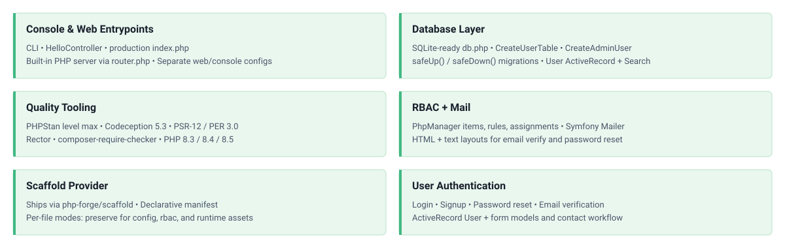

<!-- markdownlint-disable MD041 -->
<p align="center">
    <picture>
        <source media="(prefers-color-scheme: dark)" srcset="https://www.yiiframework.com/image/design/logo/yii3_full_for_dark.svg">
        <source media="(prefers-color-scheme: light)" srcset="https://www.yiiframework.com/image/design/logo/yii3_full_for_light.svg">
        
    </picture>
    <h1 align="center">App Base</h1>
</p>
<!-- markdownlint-enable MD041 -->

<p align="center">
    <a href="https://github.com/yii2-framework/app-base/actions/workflows/build.yml">
        
    </a>
    <a href="https://codecov.io/gh/yii2-framework/app-base">
        
    </a>
    <a href="https://github.com/yii2-framework/app-base/actions/workflows/static.yml">
        
    </a>
</p>

`yii2-framework/app-base` is a reusable Yii2 application scaffold. It provides standalone web actions, user
authentication, RBAC configuration, migrations, mail templates, semantic PHP views, console tooling, and secure web
entry points.

<picture>
    <source media="(max-width: 767px)" srcset="./docs/svgs/features-mobile.svg">
    
</picture>

## How it works

This package has Composer type `yii2-scaffold`. The [`php-forge/scaffold`][scaffold] plugin copies the paths declared in
`scaffold.json` into the consumer project. The resulting files belong to the consumer and can be inspected, customized,
or ejected from scaffold tracking.

The scaffold distinguishes between two modes used by this provider:

- `replace`: updates an unmodified file and skips a file changed by the consumer.
- `preserve`: creates a missing file but never overwrites an existing one.

See the [scaffold workflow](docs/scaffold.md) for update and ownership commands.

## Requirements

- PHP `>=8.3`.
- PHP ctype support, supplied by the extension or a Composer-compatible polyfill.
- Composer `^2.10`.
- Yii `^22.0@dev`.
- Scaffold plugin `^0.3@dev` in the consumer project.

## Quick start

Create an empty project directory with this `composer.json`:

```json
{
    "name": "my-company/my-app",
    "type": "project",
    "minimum-stability": "dev",
    "prefer-stable": true,
    "require": {
        "php": ">=8.3",
        "yii2-framework/app-base": "^0.1@dev",
        "php-forge/scaffold": "^0.3@dev"
    },
    "autoload": {
        "psr-4": {
            "app\\": "src"
        }
    },
    "extra": {
        "scaffold": {
            "allowed-packages": [
                "yii2-framework/app-base"
            ]
        },
        "yii\\composer\\Installer::postCreateProject": {
            "setPermission": [
                {
                    "runtime": "0775",
                    "public/assets": "0775",
                    "yii": "0755"
                }
            ]
        },
        "yii\\composer\\Installer::postInstall": {
            "generateCookieValidationKey": [
                "config/params.php"
            ]
        }
    },
    "config": {
        "allow-plugins": {
            "php-forge/scaffold": true,
            "yiisoft/yii2-composer": true
        }
    },
    "scripts": {
        "post-create-project-cmd": [
            "yii\\composer\\Installer::postCreateProject",
            "yii\\composer\\Installer::postInstall"
        ],
        "post-install-cmd": [
            "yii\\composer\\Installer::postInstall"
        ],
        "post-update-cmd": [
            "yii\\composer\\Installer::postInstall"
        ]
    }
}
```

Install, configure the seeded administrator before migration, and start the application:

```bash
composer install
./yii migrate
php -S localhost:8080 -t public public/router.php
```

Open `http://localhost:8080`. The default database is `runtime/db.sqlite`.

## What is included

```text
src/
├── commands/                 Console command example
├── migrations/               User table and administrator seed
└── usecases/
    ├── shared/               CSRF filter, user model, and view adapters
    ├── site/                 Home, about, contact, and error actions
    └── user/                 Authentication, recovery, and administration actions
config/                       Web, console, database, and application parameters
rbac/                         PhpManager roles, rules, and assignments
resources/
├── mail/                     HTML and text mail templates
└── views/                    Complete layouts and site/user PHP views
public/                       Web entry point, router, images, and asset directory
runtime/.gitignore            Runtime directory placeholder
yii                           Console entry point
```

The bundled views generate semantic HTML through UI Awesome packages. The provider intentionally does not impose a CSS
framework, JavaScript runtime, or asset build pipeline. See [presentation customization](docs/frontend-overlays.md) for
styling, view ownership, and alternate renderer options.

## Documentation

- [Installation guide](docs/installation.md)
- [Configuration reference](docs/configuration.md)
- [Scaffold workflow](docs/scaffold.md)
- [Presentation customization](docs/frontend-overlays.md)
- [Dependency policy](docs/dependencies.md)
- [Testing and quality](docs/testing.md)

## Security before deployment

The default administrator credentials, SQLite database, and file-based mail transport are development conveniences.
Complete the [production checklist](docs/configuration.md#production-checklist) before exposing a generated application.

## AI assistance

AI agents: read the [documentation index](https://yii2-framework.github.io/docs/llms.txt) and fetch the Markdown version
of a page by appending `index.md` to its URL. The
[AI agents guide](https://yii2-framework.github.io/docs/project/ai-agents/) covers skill installation, client setup and
verification.

🧭 [`yii2-framework` skill](https://yii2-framework.github.io/docs/guide/skills/yii2-framework/): Yii 22.0 application
conventions.

The hosted documentation covers Yii 22.0. If it does not match the installed revision or is unavailable, use the
[repository guides](#documentation), the source PHPDoc and the [changelog](CHANGELOG.md).

## Built with AI

[](https://openai.com/codex)

## License

This package is released under the [BSD 3-Clause License](LICENSE).

[scaffold]: https://github.com/php-forge/scaffold
